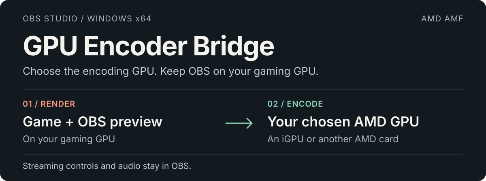

  <strong>English</strong> · <a href="docs/README.zh-CN.md">简体中文</a> · <a href="docs/README.ja-JP.md">日本語</a> · <a href="docs/README.ko-KR.md">한국어</a>

  

**[Download the Windows installer →](https://github.com/1728643928/obs-gpu-encoder/releases/download/v0.2.0-preview/GPU-Encoder-Bridge-0.2.0-preview-windows-x64-setup.exe)** · [All downloads](https://github.com/1728643928/obs-gpu-encoder/releases) · [Documentation](docs/README.md) · [Report a bug](https://github.com/1728643928/obs-gpu-encoder/issues)

**0.2.0-preview** · Windows x64 · OBS Studio 33.x · AMD AMF · GPL-2.0-or-later

**Choose the encoding GPU by its actual name. Keep OBS on your gaming GPU.**

GPU Encoder Bridge adds native, GPU-named encoders to OBS. Use an AMD iGPU or another AMD card for encoding while the game, display and OBS rendering stay on your gaming GPU. Windows GPU preferences and display cables can stay as they are.

OBS still handles your streaming platform, audio, network connection and Start/Stop Streaming buttons. The plugin needs no separate control app.

## Verified on a real two-GPU setup

**Rendering: Radeon RX 9060 XT · Encoding: Ryzen 7 9700X integrated graphics, H.264**

| Check | Observed result |
| --- | --- |
| 0.2.0 worker encoding test | 300 input frames → 300 packets, with 3 keyframes at 1080p60. |
| Earlier OBS local RTMP test | About 47 seconds of video and audio received and decoded; OBS kept rendering on the RX 9060 XT. |
| Four-language installer checks | Install/uninstall passed in all four language modes; invalid and occupied destinations were rejected. |

These are scoped validation results, not gaming benchmarks. HEVC/AV1 have capability probes, not the same full OBS streaming acceptance. Public-platform receiving has not been validated. [Read the full validation record →](docs/validation.md)

## What you can choose

- **GPU + codec, together.** Entries identify the actual adapter and H.264, HEVC or AV1. Only combinations that pass a real probe are offered; your streaming service may further limit codecs.
- **Familiar encoder controls.** CBR/VBR, bitrate, keyframe interval and Speed/Balanced/Quality presets, inside OBS.
- **Explicit device selection.** Display-only virtual aliases are filtered; real identical-model cards remain separate. An error never silently switches to another GPU or software encoding.
- **Four languages.** English, 简体中文, 日本語 and 한국어 in the plugin, EXE installer and getting-started guides.

## Install and stream

1. **Close OBS** and download the installer above.
2. Choose a language and your **OBS root folder**. The wizard detects common installations, offers an optional cancellable scan of all local fixed drives, and checks OBS 33.x x64 and its required DLLs.
3. Start OBS → **Settings → Output → Advanced → Streaming**. Choose the **AMF Bridge** encoder carrying your intended GPU name.
4. Set up your platform and audio in OBS, then use **Start Streaming** as usual.

A typical entry is **AMD Radeon(TM) Graphics — H.264 [GPU 1 / AMF Bridge]**. GPU numbers reflect the current DXGI order; recheck the selection after hardware changes.

For an initial configuration, the plugin provides H.264, CBR, 2-second keyframes and Balanced. Set bitrate to your platform's requirements. Disable Twitch Enhanced Broadcasting if it would override your chosen encoder.

Where the installer puts files, and what the disk scan does

Choose the OBS root, not an arbitrary plugin folder. The installer writes to:

| Under your OBS root | File |
| --- | --- |
| `obs-plugins/64bit/` | `obs-gpu-encoder.dll` and `obs-gpu-encoder-worker.exe` |
| `data/obs-plugins/obs-gpu-encoder/` | Four-language resources, notices and the uninstaller. |

The scan enumerates directories on local fixed drives. It does not read personal document contents or upload files. Inaccessible folders and reparse points are skipped. Network/removable drives and volumes reachable only through links require manual browsing. Large drives can take time; the scan can be stopped.

The default installer requests administrator access for protected installations. A writable portable installation can use **/CURRENTUSER**. The EXE is currently unsigned. [Installer details](docs/installer.md)

Manual ZIP installation and uninstall

Merge the ZIP's **obs-plugins** and **data** directories into the OBS root. Keep the plugin DLL and worker EXE together; do not replace OBS's own DLLs.

To uninstall, close OBS and use GPU Encoder Bridge in Windows Installed Apps, or run **data/obs-plugins/obs-gpu-encoder/uninstall/unins000.exe** under that OBS root. The installer removes its recorded plugin files and retains OBS, profiles and other plugins. For a manual install, select another encoder before removing this plugin's DLL, worker and data directory.

## Compatibility and tradeoffs

| Area | Current preview |
| --- | --- |
| Platform | Windows x64; OBS 33 / avcodec 62 / avutil 60 ABI. |
| Encoding | AMD AMF; H.264, HEVC and AV1 where a device probe succeeds. |
| Video | SDR / NV12 / 8-bit. HDR and 10-bit are rejected. |
| Other vendors | Intel QSV and NVIDIA NVENC are not implemented. |
| Frame transfer | System memory → local worker → chosen AMD GPU. Cross-GPU zero-copy is not implemented. |

The hidden worker isolates AMF initialization and binds the selected GPU explicitly; encoded packets return to OBS. This transfer has a cost, so a game-performance improvement is not guaranteed. Other GPUs, other OBS ABI versions and public streaming services need further validation. [Architecture](docs/architecture.md) · [Testing](docs/testing.md)

## Open source, ready to continue

The plugin, worker, installer, translations, tests and release workflow are all available under **GPL-2.0-or-later**, with third-party notices retained. There is no closed paid component, CLA, telemetry or online activation.

Fork, create branches, modify and redistribute under the license. Forks can publish their own Releases using their own GitHub Actions token, without the original maintainer's secrets or machine. Upstream release access is granted by the repository owner.

[Contribute](CONTRIBUTING.md) · [Maintainer handover](GOVERNANCE.md) · [Release your fork](docs/releasing.md) · [License](LICENSE) · [Third-party notices](THIRD-PARTY.md)

Build from source

Requirements: Windows x64, Node.js 22+ and Git. No Visual Studio or private SDK is required.

~~~powershell
node scripts/check-locales.mjs
node scripts/build.mjs --download-obs --tests
node scripts/build-installer.mjs
node scripts/package.mjs
~~~

For an existing OBS installation, replace **--download-obs** with **--obs-root "C:\Program Files\obs-studio"**. Public toolchain/source downloads are pinned and SHA-256 verified. Outputs go to **dist/** and **release/**. Building does not install the plugin or change OBS profiles.

Repository map

| Directory | Start here |
| --- | --- |
| [src/](src/README.md) | Native OBS integration, AMD backend, GPU filtering and worker communication. |
| [installer/](installer/README.md) | EXE wizard, OBS discovery, target validation and four-language messages. |
| [scripts/](scripts/README.md) | Build, locale checks, installer tests, packaging and Releases. |
| [tests/](tests/README.md) | CPU regressions, GPU harnesses and file-lock fixtures. |
| [data/](data/README.md) | Four OBS locale resources and translation rules. |
| [docs/](docs/README.md) | Setup, architecture, testing, validation and release handover. |
| [.github/](.github/AUTOMATION.md) | CI jobs, release permissions and bug-report intake. |
| [assets/readme/](assets/readme/README.md) | Editable four-language artwork and its dependency-free generator. |
| [third-party/](third-party/README.md) | Upstream runtime, toolchain and installer license texts. |

[CHANGELOG.md](CHANGELOG.md) records changes; [version.json](version.json) drives build/release versions. [.gitattributes](.gitattributes) defines line endings and [.gitignore](.gitignore) excludes generated files. Contribution, governance, license and dependency details are linked above.

