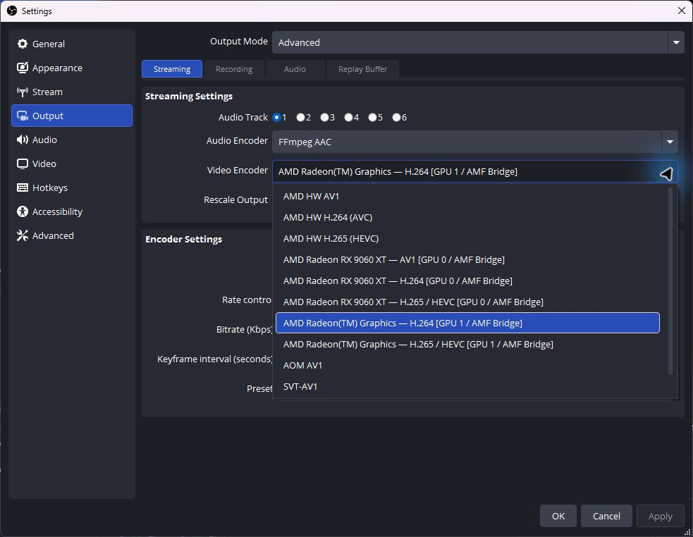
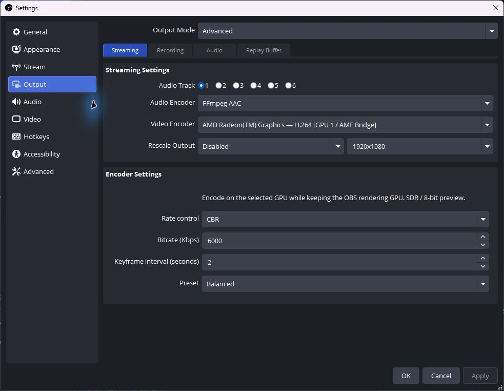
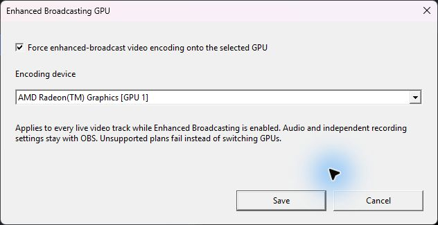
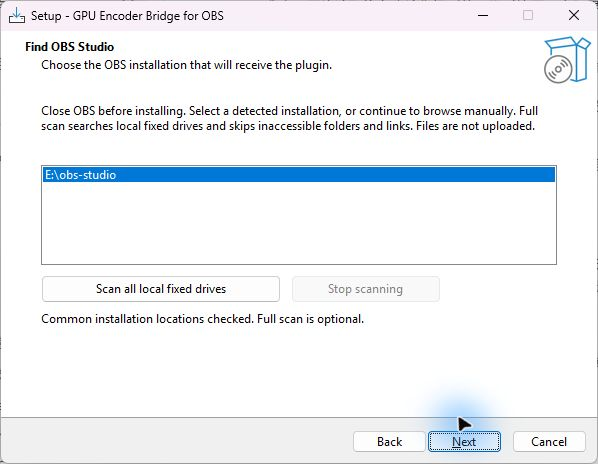

  <strong>English</strong> · <a href="docs/README.zh-CN.md">简体中文</a> · <a href="docs/README.zh-TW.md">繁體中文（台灣）</a> · <a href="docs/README.ja-JP.md">日本語</a> · <a href="docs/README.ko-KR.md">한국어</a>

  

**[Download the Windows installer →](https://github.com/1728643928/obs-gpu-encoder/releases/download/v0.3.2/GPU-Encoder-Bridge-0.3.2-windows-x64-setup.exe)** · [All downloads](https://github.com/1728643928/obs-gpu-encoder/releases) · [Documentation](docs/README.md) · [Report a bug](https://github.com/1728643928/obs-gpu-encoder/issues)

**0.3.2** · Windows x64 · OBS Studio 33.x · AMD AMF · GPL-2.0-or-later

**Choose the encoding GPU by its actual name. Keep OBS on your gaming GPU.**

GPU Encoder Bridge adds native, GPU-named encoders to OBS. Use an AMD iGPU or another AMD card for encoding while the game, display and OBS rendering stay on your gaming GPU. Windows GPU preferences and display cables can stay as they are.

OBS still handles your streaming platform, audio, network connection and Start/Stop Streaming buttons. The plugin needs no separate control app.

## Why this plugin exists

**Two AMD GPUs, but no separate GPU choices in the stock encoder list.** This project began with a PC containing a **Ryzen 7 9700X iGPU and a Radeon RX 9060 XT**. In that setup, OBS offered entries such as **AMD HW H.264 (AVC)** and **AMD HW H.265 (HEVC)**, rather than a separate entry for each physical AMD GPU. OBS 33's [built-in texture AMF path](https://github.com/obsproject/obs-studio/blob/33.0.0/plugins/obs-ffmpeg/texture-amf.cpp#L356-L373) uses the OBS rendering adapter.

The goal was to keep the game, display and OBS rendering on the RX 9060 XT while using the 9700X iGPU for encoding, without changing Windows GPU preferences or connecting a display to the iGPU. **That missing independent encoding-GPU choice is why GPU Encoder Bridge was created.**

| Encoder selection in the original setup | Example labels (shortened) |
| --- | --- |
| Stock OBS | **AMD HW H.264 (AVC)** — one codec entry without separate GPU model names. |
| GPU Encoder Bridge | Separate **RX 9060 XT — H.264** and **Radeon(TM) Graphics — H.264** entries, each bound to the named device. |

The plugin probes each AMD GPU and adds the supported **GPU model + codec** combinations. You can explicitly choose which physical GPU does the encoding while OBS keeps its rendering GPU.

## Inside OBS

Open **Settings → Output → Advanced → Streaming → Video Encoder** and choose an entry ending in **AMF Bridge**.

  

This real 0.3.0-preview capture shows two GPUs and their available formats. **AMD HW** entries are OBS's built-in encoders; this plugin adds the GPU-named **AMF Bridge** entries. A streaming service may hide formats it does not accept.

See the selected iGPU and its encoder controls

  

The selected device is the Ryzen 7 9700X iGPU. The bitrate and preset shown are example values, not a performance result. Screenshots on this page use the English UI. Switch the page language above to see matching Simplified Chinese, Traditional Chinese (Taiwan), Japanese or Korean captures.

## Enhanced Broadcasting

**Platform scope:** this is OBS's **Multitrack Video** mode, called **Enhanced Broadcasting** on Twitch. OBS 33 also configures it for Amazon IVS, Whowatch, PandaTV and Dolby OptiView Real-time; availability depends on the service/account. **YouTube does not use this OBS mode**: select a GPU-named AMF Bridge encoder in normal Output settings. Codec support (H.264/HEVC/AV1) is a separate question. These upstream integrations are not claims of end-to-end service validation for this plugin. [Platform details](docs/enhanced-broadcasting.md#platform-scope)

**Keep Enhanced Broadcasting enabled and choose its encoding GPU separately.** In **Tools → GPU Encoder Bridge: Enhanced Broadcasting**, enable GPU binding, select your iGPU and save. This profile-specific setting replaces every live video track after OBS negotiates the plan, even when its usual encoder dropdown is locked.

Independent recording choices stay unchanged. OBS's own enhanced-stream dump follows the live encoders. Missing GPUs and incompatible plans block startup instead of falling back to another GPU. [Setup, behavior and limits →](docs/enhanced-broadcasting.md)

  

## Verified on a real two-GPU setup

**Rendering: Radeon RX 9060 XT · Encoding: Ryzen 7 9700X integrated graphics, H.264**

| Check | Observed result |
| --- | --- |
| 0.2.0 worker encoding test | 300 input frames → 300 packets, with 3 keyframes at 1080p60. |
| Earlier OBS local RTMP test | About 47 seconds of video and audio received and decoded; OBS kept rendering on the RX 9060 XT. |
| 0.2.0 four-language installer checks | Install/uninstall passed in all four language modes; invalid and occupied destinations were rejected. |

These are scoped validation results, not gaming benchmarks. HEVC/AV1 have capability probes, not the same full OBS streaming acceptance. Public-platform receiving has not been validated. [Read the full validation record →](docs/validation.md)

## What you can choose

- **GPU + codec, together.** Entries identify the actual adapter and H.264, HEVC or AV1. Only combinations that pass a real probe are offered; your streaming service may further limit codecs.
- **Familiar encoder controls.** CBR/VBR, bitrate, keyframe interval and Speed/Balanced/Quality presets, inside OBS.
- **Explicit device selection.** Display-only virtual aliases are filtered; real identical-model cards remain separate. An error never silently switches to another GPU or software encoding.
- **Five language options.** English, 简体中文, 繁體中文（台灣）, 日本語 and 한국어 in the plugin, EXE installer and getting-started guides.

## Install and stream

1. **Close OBS** and download the installer above.
2. Choose a language and your **OBS root folder**. The wizard detects common installations, offers an optional cancellable scan of all local fixed drives, and checks OBS 33.x x64 and its required DLLs.
3. Start OBS → **Settings → Output → Advanced → Streaming**. Choose the **AMF Bridge** encoder carrying your intended GPU name.
4. Set up your platform and audio in OBS, then use **Start Streaming** as usual.

A typical entry is **AMD Radeon(TM) Graphics — H.264 [GPU 1 / AMF Bridge]**. GPU numbers reflect the current DXGI order; recheck the selection after hardware changes.

For an initial configuration, the plugin provides H.264, CBR, 2-second keyframes and Balanced. Set bitrate to your platform's requirements. For Twitch Enhanced Broadcasting, also configure the plugin's [enhanced-broadcast GPU setting](docs/enhanced-broadcasting.md).

See the installer find OBS

  

The wizard finds an existing OBS installation, offers an optional full scan and lets you continue to validate the OBS root. This screenshot shows the discovery step, before installation.

Where the installer puts files, and what the disk scan does

Choose the OBS root, not an arbitrary plugin folder. The installer writes to:

| Under your OBS root | File |
| --- | --- |
| `obs-plugins/64bit/` | `obs-gpu-encoder.dll` and `obs-gpu-encoder-worker.exe` |
| `data/obs-plugins/obs-gpu-encoder/` | Five-language resources, notices and the uninstaller. |

The scan enumerates directories on local fixed drives. It does not read personal document contents or upload files. Inaccessible folders and reparse points are skipped. Network/removable drives and volumes reachable only through links require manual browsing. Large drives can take time; the scan can be stopped.

The default installer requests administrator access for protected installations. A writable portable installation can use **/CURRENTUSER**. The EXE is currently unsigned. [Installer details](docs/installer.md)

Manual ZIP installation and uninstall

Merge the ZIP's **obs-plugins** and **data** directories into the OBS root. Keep the plugin DLL and worker EXE together; do not replace OBS's own DLLs.

To uninstall, close OBS and use GPU Encoder Bridge in Windows Installed Apps, or run **data/obs-plugins/obs-gpu-encoder/uninstall/unins000.exe** under that OBS root. The installer removes its recorded plugin files and retains OBS, profiles and other plugins. For a manual install, select another encoder before removing this plugin's DLL, worker and data directory.

## Compatibility and tradeoffs

| Area | Current preview |
| --- | --- |
| Platform | Windows x64; OBS 33 / avcodec 62 / avutil 60 ABI. |
| Encoding | AMD AMF; H.264, HEVC and AV1 where a device probe succeeds. |
| Video | SDR / NV12 / 8-bit. HDR and 10-bit are rejected. |
| Other vendors | Intel QSV and NVIDIA NVENC are not implemented. |
| Frame transfer | System memory → local worker → chosen AMD GPU. Cross-GPU zero-copy is not implemented. |

The hidden worker isolates AMF initialization and binds the selected GPU explicitly; encoded packets return to OBS. This transfer has a cost, so a game-performance improvement is not guaranteed. Other GPUs, other OBS ABI versions and public streaming services need further validation. [Architecture](docs/architecture.md) · [Testing](docs/testing.md)

## Acknowledgements and sources

This project builds on the following work. The scope of each reference or reused component is listed explicitly.

| Project | What it contributes here |
| --- | --- |
| [OBS Studio](https://github.com/obsproject/obs-studio/tree/33.0.0) | Encoder API and headers; its AMF implementation was an implementation reference. OBS supplies rendering, audio and stream publishing. |
| [FFmpeg](https://github.com/FFmpeg/FFmpeg/tree/n8.0) | The actual AMF codec implementations and D3D11 hardware-context APIs, used through OBS-provided libavcodec/libavutil DLLs. |
| [AMD AMF](https://github.com/GPUOpen-LibrariesAndSDKs/AMF) | Driver-provided hardware encoding runtime; AMD's FFmpeg/AMF guide informed device selection and validation. |
| [Inno Setup](https://github.com/jrsoftware/issrc/tree/is-6_7_3) | EXE installer engine and standard UI translations. The Simplified Chinese file is reused unchanged from upstream and credits [Zhenghan Yang / Kira](https://github.com/kira-96/Inno-Setup-Chinese-Simplified-Translation). Traditional Chinese is based on upstream messages by **Enfeng Tsao**, retaining the earlier **Samuel Lee** credit; only its language selector name is adjusted. |
| [Zig](https://github.com/ziglang/zig/tree/0.14.1) and its bundled LLVM/MinGW toolchain | Compiler, linker, Windows headers and linked C/C++ runtime components. |
| [oil-oil/beautify-github-readme](https://github.com/oil-oil/beautify-github-readme) | README structure and visual-design guidance. The GPU-role SVGs and their generator were created for this repository. |

[Detailed references, reused files and license notices →](THIRD-PARTY.md)

## Open source, ready to continue

Project-authored plugin, worker, installer logic, translations, tests and release workflow are available under **GPL-2.0-or-later**. Reused components and files retain their upstream licenses and notices. There is no closed paid component, CLA, telemetry or online activation.

Fork, create branches, modify and redistribute under the license. Forks can publish their own Releases using their own GitHub Actions token, without the original maintainer's secrets or machine. Upstream release access is granted by the repository owner.

[Contribute](CONTRIBUTING.md) · [Maintainer handover](GOVERNANCE.md) · [Release your fork](docs/releasing.md) · [License](LICENSE) · [Third-party notices](THIRD-PARTY.md)

Build from source

Requirements: Windows x64, Node.js 22+ and Git. No Visual Studio or private SDK is required.

~~~powershell
node scripts/check-locales.mjs
node scripts/build.mjs --download-obs --tests
node scripts/build-installer.mjs
node scripts/package.mjs
~~~

For an existing OBS installation, replace **--download-obs** with **--obs-root "C:\Program Files\obs-studio"**. Public toolchain/source downloads are pinned and SHA-256 verified. Outputs go to **dist/** and **release/**. Building does not install the plugin or change OBS profiles.

Repository map

| Directory | Start here |
| --- | --- |
| [src/](src/README.md) | Native OBS integration, AMD backend, GPU filtering and worker communication. |
| [installer/](installer/README.md) | EXE wizard, OBS discovery, target validation and five-language messages. |
| [scripts/](scripts/README.md) | Build, locale checks, installer tests, packaging and Releases. |
| [tests/](tests/README.md) | CPU regressions, GPU harnesses and file-lock fixtures. |
| [data/](data/README.md) | Five OBS locale resources and translation rules. |
| [docs/](docs/README.md) | Setup, architecture, testing, validation and release handover. |
| [.github/](.github/AUTOMATION.md) | CI jobs, release permissions and bug-report intake. |
| [assets/readme/](assets/readme/README.md) | Editable five-language artwork and its dependency-free generator. |
| [third-party/](third-party/README.md) | Upstream runtime, toolchain and installer license texts. |

[CHANGELOG.md](CHANGELOG.md) records changes; [version.json](version.json) drives build/release versions. [.gitattributes](.gitattributes) defines line endings and [.gitignore](.gitignore) excludes generated files. Contribution, governance, license and dependency details are linked above.

