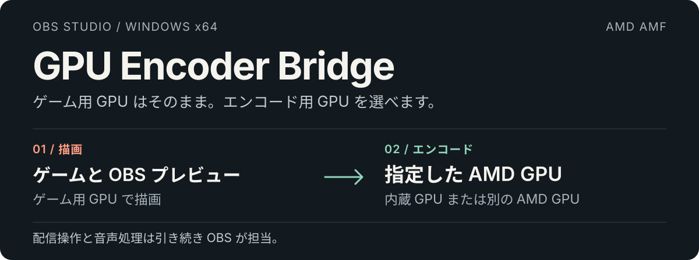

  <a href="../README.md">English</a> · <a href="README.zh-CN.md">简体中文</a> · <strong>日本語</strong> · <a href="README.ko-KR.md">한국어</a>

  

**[Windows インストーラーをダウンロード →](https://github.com/1728643928/obs-gpu-encoder/releases/download/v0.2.0-preview/GPU-Encoder-Bridge-0.2.0-preview-windows-x64-setup.exe)** · [すべての配布物](https://github.com/1728643928/obs-gpu-encoder/releases) · [ドキュメント](README.md) · [不具合報告](https://github.com/1728643928/obs-gpu-encoder/issues)

**0.2.0-preview** · Windows x64 · OBS Studio 33.x · AMD AMF · GPL-2.0-or-later

**エンコード用 GPU を実際の名前で選択。OBS はゲーム用 GPU のまま。**

GPU Encoder Bridge は GPU 名付きのネイティブエンコーダーを OBS に追加します。AMD 内蔵 GPU または別の AMD カードでエンコードしながら、ゲーム、ディスプレイ、OBS の描画はゲーム用 GPU に残せます。Windows の GPU 設定やモニターの接続を変更する必要はありません。

配信サービス、音声、ネットワーク、配信開始・停止は引き続き OBS が担当します。別の制御アプリは不要です。

## OBS での表示

**設定 → 出力 → 詳細 → 配信 → 映像エンコーダー**を開き、**AMF Bridge** と付いた項目を選択します。

  

0.2.0-preview の実際の画面で、2 台の GPU と利用可能な形式を示しています。**AMD HW** は OBS 標準のエンコーダーです。本プラグインは GPU 名付きの **AMF Bridge** 項目を追加します。配信サービスによって形式が非表示になることがあります。

内蔵 GPU 選択後のエンコーダー設定を見る

  

選択したデバイスは Ryzen 7 9700X 内蔵 GPU です。ビットレートとプリセットは設定例であり、性能の測定結果ではありません。画面は英語ですが、中国語、日本語、韓国語にも対応します。

## 実際の 2 GPU 環境で確認

**描画：Radeon RX 9060 XT · エンコード：Ryzen 7 9700X 内蔵 GPU、H.264**

| 検証 | 確認した結果 |
| --- | --- |
| 0.2.0 ワーカーテスト | 1080p60 で入力 300 フレーム → 出力 300 パケット、キーフレーム 3。 |
| 以前の OBS ローカル RTMP テスト | 約 47 秒の映像と音声を受信・デコード。OBS の描画は RX 9060 XT を維持。 |
| 4 言語のインストーラーテスト | 全言語で導入・削除を確認。無効な配置先と使用中のファイルを拒否。 |

これらは範囲を限定した検証結果であり、ゲーム性能のベンチマークではありません。HEVC/AV1 は能力検証のみで、同等の OBS 配信テストは未実施です。公開配信サービスでの受信も未検証です。[詳しい検証記録 →](validation.md)

## 選択できるもの

- **GPU とコーデック。** 実際のデバイス名と H.264、HEVC、AV1 を表示します。実機の短いエンコード検証に成功した組み合わせのみ提供し、配信サービス側の制限も適用されます。
- **使い慣れた設定。** OBS 内で CBR/VBR、ビットレート、キーフレーム間隔、速度・バランス・品質プリセットを設定できます。
- **明示的なデバイス指定。** 表示専用の仮想アダプターを除外し、実在する同型カードは別々に保持します。失敗時に他の GPU やソフトウェアへ自動変更しません。
- **4 言語。** プラグイン、EXE と導入ガイドに英語、簡体字中国語、日本語、韓国語を用意しています。

## インストールして配信

1. **OBS を終了**し、上のインストーラーをダウンロードします。
2. 言語と **OBS のルートフォルダー**を選択します。一般的な導入先の自動検出、停止可能な全ローカル固定ドライブ検索、手動参照を利用できます。コピー前に OBS 33.x x64 と必要 DLL を確認します。
3. OBS を起動 → **設定 → 出力 → 詳細 → 配信**で、目的の GPU 名が付いた **AMF Bridge** エンコーダーを選択します。
4. OBS でサービスと音声を設定し、通常の **配信開始**を使用します。

表示例：**AMD Radeon(TM) Graphics — H.264 [GPU 1 / AMF Bridge]**。GPU 番号は現在の DXGI 列挙順です。ハードウェア変更後は再確認してください。

最初の設定には H.264、CBR、キーフレーム 2 秒、バランスを利用できます。ビットレートはサービスの要件に合わせてください。選択したエンコーダーを上書きする場合は Twitch Enhanced Broadcasting を無効にしてください。

OBS を検出するインストーラーを見る

  

検出した OBS を一覧表示し、任意の全ドライブ検索と、続行後のルート検証を提供します。画面はインストール前の検出段階です。

正確な配置先とドライブ検索の範囲

任意のプラグインフォルダーではなく OBS のルートを選択します。配置先は次のとおりです。

| OBS ルートからのパス | ファイル |
| --- | --- |
| `obs-plugins/64bit/` | `obs-gpu-encoder.dll` と `obs-gpu-encoder-worker.exe` |
| `data/obs-plugins/obs-gpu-encoder/` | 4 言語リソース、ライセンス表示、アンインストーラー。 |

検索はローカル固定ドライブのディレクトリを列挙します。個人文書の内容を読んだりアップロードしたりしません。アクセス不能なフォルダーと再解析ポイントを省略します。ネットワーク・リムーバブルドライブやリンク経由のみのボリュームは手動参照してください。大きなドライブは時間がかかりますが、途中で停止できます。

保護された配置先には既定で管理者権限を要求します。書き込み可能なポータブル導入では **/CURRENTUSER** を利用できます。EXE は現在未署名です。[インストーラーの詳細](installer.md)

手動 ZIP 導入とアンインストール

ZIP 内の **obs-plugins** と **data** を OBS ルートに統合します。プラグイン DLL と worker EXE を一緒に配置し、OBS 自身の DLL は置き換えないでください。

削除前に OBS を終了し、Windows のインストール済みアプリから GPU Encoder Bridge を選ぶか、対象 OBS の **data/obs-plugins/obs-gpu-encoder/uninstall/unins000.exe** を実行します。記録されたプラグインファイルのみを削除し、OBS、設定、他のプラグインを保持します。手動導入では別のエンコーダーを選んでから、本プラグインの DLL、worker、データを削除してください。

## 対応範囲とトレードオフ

| 項目 | 現在のプレビュー |
| --- | --- |
| 環境 | Windows x64、OBS 33 / avcodec 62 / avutil 60 ABI。 |
| エンコード | AMD AMF。能力検証に成功した H.264、HEVC、AV1。 |
| 映像 | SDR / NV12 / 8 ビット。HDR と 10 ビットは拒否。 |
| 他社 GPU | Intel QSV と NVIDIA NVENC は未実装。 |
| フレーム転送 | システムメモリ → ローカルワーカー → 指定 AMD GPU。GPU 間ゼロコピーは未実装。 |

非表示のワーカーが AMF 初期化を分離し、指定 GPU を明示的に使用して、圧縮済みパケットを OBS に返します。転送コストがあるため、ゲーム性能の向上は保証しません。他の GPU、OBS ABI、公開配信サービスには追加検証が必要です。[構成](architecture.md) · [テスト](testing.md)

## 完全な公開ソースから継続開発

プラグイン、ワーカー、インストーラー、翻訳、テスト、公開ワークフローを **GPL-2.0-or-later** で提供し、第三者表示を保持します。非公開の有料部品、CLA、テレメトリー、オンライン認証はありません。

ライセンスに従って Fork、ブランチ作成、変更、再配布ができます。Fork は自分のリポジトリの GitHub Actions トークンで独自 Releases を公開でき、元保守者の秘密や PC は不要です。上流の公開権限は所有者が付与します。

[貢献](../CONTRIBUTING.md) · [保守と引き継ぎ](../GOVERNANCE.md) · [Fork の公開](releasing.md) · [ライセンス](../LICENSE) · [第三者表示](../THIRD-PARTY.md)

ソースからビルド

Windows x64、Node.js 22+、Git が必要です。Visual Studio や非公開 SDK は不要です。

~~~powershell
node scripts/check-locales.mjs
node scripts/build.mjs --download-obs --tests
node scripts/build-installer.mjs
node scripts/package.mjs
~~~

既存の OBS を使用する場合は **--download-obs** を **--obs-root "C:\Program Files\obs-studio"** に置き換えます。公開ツールとソースの固定 SHA-256 を検証します。出力先は **dist/** と **release/** です。ビルドはプラグインの導入や OBS 設定の変更を行いません。

リポジトリ案内

| ディレクトリ | 役割と入口 |
| --- | --- |
| [src/](../src/README.md) | OBS 連携、AMD バックエンド、GPU 選別、ワーカー通信。 |
| [installer/](../installer/README.md) | EXE、OBS 検出、配置先検証、4 言語表示。 |
| [scripts/](../scripts/README.md) | ビルド、翻訳検査、導入テスト、パッケージ、公開。 |
| [tests/](../tests/README.md) | CPU 回帰、実機 GPU テスト、ファイルロック補助。 |
| [data/](../data/README.md) | OBS の 4 言語リソースと翻訳規則。 |
| [docs/](README.md) | 導入、構成、テスト、検証、公開と引き継ぎ。 |
| [.github/](../.github/AUTOMATION.md) | CI、公開権限、不具合テンプレート。 |
| [assets/readme/](../assets/readme/README.md) | 編集可能な 4 言語の図と依存関係不要の生成スクリプト。 |
| [third-party/](../third-party/README.md) | ランタイム、ツールチェーン、インストーラーの第三者ライセンス。 |

[CHANGELOG.md](../CHANGELOG.md) は変更履歴、[version.json](../version.json) はビルド・公開バージョンを管理します。[.gitattributes](../.gitattributes) は改行、[.gitignore](../.gitignore) は生成物の除外を定義します。貢献、権限、ライセンス、依存関係は上のリンクを参照してください。

