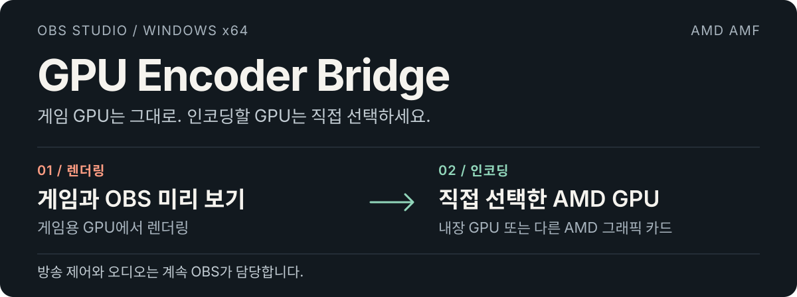
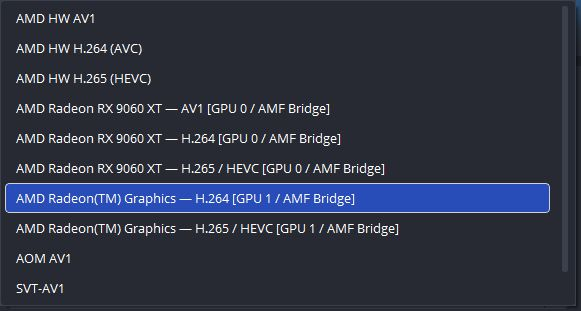
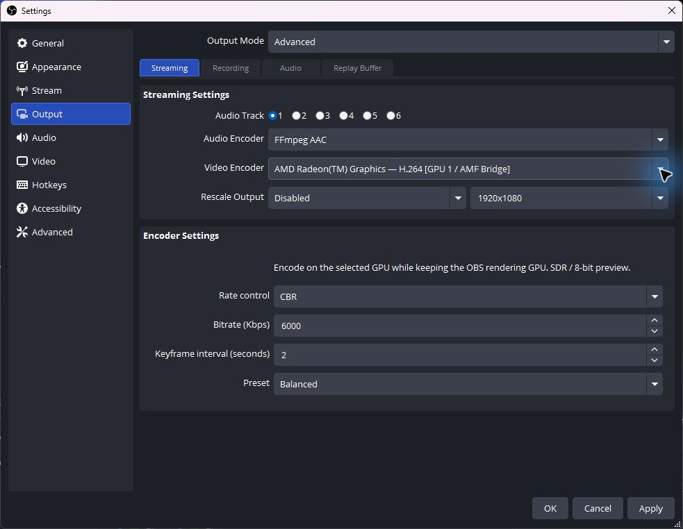
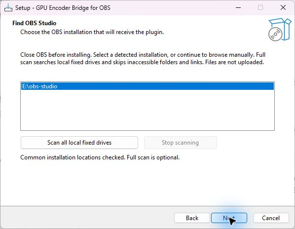

  <a href="../README.md">English</a> · <a href="README.zh-CN.md">简体中文</a> · <a href="README.ja-JP.md">日本語</a> · <strong>한국어</strong>

  

**[Windows 설치 프로그램 다운로드 →](https://github.com/1728643928/obs-gpu-encoder/releases/download/v0.2.0-preview/GPU-Encoder-Bridge-0.2.0-preview-windows-x64-setup.exe)** · [모든 다운로드](https://github.com/1728643928/obs-gpu-encoder/releases) · [문서](README.md) · [버그 신고](https://github.com/1728643928/obs-gpu-encoder/issues)

**0.2.0-preview** · Windows x64 · OBS Studio 33.x · AMD AMF · GPL-2.0-or-later

**실제 GPU 이름으로 인코딩 장치를 선택하세요. OBS는 게임 GPU에서 계속 실행됩니다.**

GPU Encoder Bridge는 GPU 이름이 표시되는 기본 인코더를 OBS에 추가합니다. AMD 내장 GPU나 다른 AMD 카드로 인코딩하면서 게임, 디스플레이 및 OBS 렌더링은 게임용 GPU에 유지할 수 있습니다. Windows GPU 기본 설정이나 모니터 연결을 바꿀 필요가 없습니다.

방송 서비스, 오디오, 네트워크 및 방송 시작·종료는 계속 OBS가 처리합니다. 별도의 제어 앱이 필요하지 않습니다.

## OBS에서 보이는 모습

**설정 → 출력 → 고급 → 방송 → 비디오 인코더**에서 **AMF Bridge**로 끝나는 항목을 선택합니다.

  

0.2.0-preview의 실제 화면으로 두 GPU와 사용 가능한 형식을 보여 줍니다. **AMD HW**는 OBS 기본 인코더이며, 이 플러그인은 GPU 이름이 붙은 **AMF Bridge** 항목을 추가합니다. 방송 서비스가 지원하지 않는 형식은 숨겨질 수 있습니다.

내장 GPU를 선택한 전체 인코더 설정 보기

  

선택한 장치는 Ryzen 7 9700X 내장 GPU입니다. 비트레이트와 프리셋은 설정 예시이며 성능 측정 결과가 아닙니다. 화면은 영어이며 플러그인은 중국어, 일본어와 한국어도 지원합니다.

## 실제 두 GPU 환경에서 검증

**렌더링: Radeon RX 9060 XT · 인코딩: Ryzen 7 9700X 내장 GPU, H.264**

| 검사 | 확인한 결과 |
| --- | --- |
| 0.2.0 작업 프로세스 테스트 | 1080p60 입력 300프레임 → 출력 300패킷, 키프레임 3개. |
| 이전 OBS 로컬 RTMP 테스트 | 약 47초의 영상과 오디오 수신·디코딩 성공. OBS 렌더링은 RX 9060 XT 유지. |
| 네 언어 설치 프로그램 검사 | 모든 언어에서 설치·제거 통과. 잘못된 경로와 사용 중인 파일 거부. |

검증 범위가 정해진 결과이며 게임 성능 벤치마크가 아닙니다. HEVC/AV1은 기능 확인만 수행했으며 동일한 OBS 방송 검증은 거치지 않았습니다. 공개 방송 서비스의 수신도 검증하지 않았습니다. [전체 검증 기록 →](validation.md)

## 선택할 수 있는 기능

- **GPU와 코덱을 함께.** 실제 장치 이름과 H.264, HEVC 또는 AV1을 표시합니다. 실제 인코딩 검사에 통과한 조합만 제공하며 방송 서비스가 코덱을 추가로 제한할 수 있습니다.
- **익숙한 인코더 설정.** OBS 안에서 CBR/VBR, 비트레이트, 키프레임 간격과 속도·균형·품질 프리셋을 설정합니다.
- **명시적인 장치 지정.** 표시 전용 가상 어댑터는 걸러내고 실제 동일 모델 카드는 각각 유지합니다. 오류가 발생해도 다른 GPU나 소프트웨어 인코딩으로 자동 전환하지 않습니다.
- **네 언어.** 플러그인, EXE 및 시작 가이드에 영어, 중국어 간체, 일본어와 한국어를 제공합니다.

## 설치하고 방송하기

1. **OBS를 종료**하고 위 설치 프로그램을 다운로드합니다.
2. 언어와 **OBS 루트 폴더**를 선택합니다. 일반 경로 자동 탐색, 중단 가능한 전체 로컬 고정 드라이브 검색, 직접 경로 지정을 지원합니다. 복사 전에 OBS 33.x x64 및 필수 DLL을 확인합니다.
3. OBS 실행 → **설정 → 출력 → 고급 → 방송**에서 원하는 GPU 이름이 붙은 **AMF Bridge** 인코더를 선택합니다.
4. OBS에서 서비스와 오디오를 설정한 뒤 평소처럼 **방송 시작**을 누릅니다.

표시 예: **AMD Radeon(TM) Graphics — H.264 [GPU 1 / AMF Bridge]**. GPU 번호는 현재 DXGI 열거 순서이므로 하드웨어 변경 후 다시 확인하세요.

시작 설정으로 H.264, CBR, 키프레임 2초, 균형을 사용할 수 있습니다. 비트레이트는 서비스 요구에 맞추세요. 인코더 선택을 덮어쓰는 경우 Twitch Enhanced Broadcasting을 끄세요.

OBS를 찾는 설치 프로그램 보기

  

발견한 OBS 위치를 표시하고 선택적인 전체 드라이브 검색을 제공합니다. 계속하면 OBS 루트를 검사합니다. 이미지는 설치 전 탐색 단계입니다.

정확한 설치 위치와 드라이브 검색 범위

임의의 플러그인 폴더 대신 OBS 루트를 선택하세요. 설치 프로그램이 다음 위치에 배치합니다.

| OBS 루트 아래 경로 | 파일 |
| --- | --- |
| `obs-plugins/64bit/` | `obs-gpu-encoder.dll` 및 `obs-gpu-encoder-worker.exe` |
| `data/obs-plugins/obs-gpu-encoder/` | 네 언어 리소스, 고지 및 제거 프로그램. |

검색은 로컬 고정 드라이브의 디렉터리를 열거합니다. 개인 문서 내용을 읽거나 업로드하지 않습니다. 접근 불가 폴더와 재분석 지점은 건너뜁니다. 네트워크·이동식 드라이브 및 링크로만 접근하는 볼륨은 직접 경로를 지정하세요. 큰 드라이브는 시간이 걸릴 수 있으며 언제든 검색을 중단할 수 있습니다.

보호된 경로에는 기본적으로 관리자 권한을 요청합니다. 쓰기 가능한 포터블 설치는 **/CURRENTUSER**를 사용할 수 있습니다. 현재 EXE에는 디지털 서명이 없습니다. [설치 프로그램 상세](installer.md)

수동 ZIP 설치와 제거

ZIP의 **obs-plugins**와 **data** 폴더를 OBS 루트에 합칩니다. 플러그인 DLL과 worker EXE를 함께 설치하고 OBS 자체 DLL은 덮어쓰지 마세요.

제거 전에 OBS를 종료하고 Windows 설치된 앱의 GPU Encoder Bridge를 사용하거나 해당 OBS 아래 **data/obs-plugins/obs-gpu-encoder/uninstall/unins000.exe**를 실행합니다. 기록된 플러그인 파일만 제거하며 OBS, 설정과 다른 플러그인은 유지합니다. 수동 설치는 다른 인코더를 선택한 뒤 이 플러그인의 DLL, worker 및 데이터 폴더를 제거하세요.

## 호환 범위와 고려 사항

| 항목 | 현재 시험판 |
| --- | --- |
| 환경 | Windows x64, OBS 33 / avcodec 62 / avutil 60 ABI. |
| 인코딩 | AMD AMF. 장치 검사에 통과한 H.264, HEVC 및 AV1. |
| 영상 | SDR / NV12 / 8비트. HDR 및 10비트는 거부. |
| 다른 제조사 | Intel QSV와 NVIDIA NVENC는 미구현. |
| 프레임 전송 | 시스템 메모리 → 로컬 작업 프로세스 → 지정한 AMD GPU. GPU 간 제로 카피는 미구현. |

숨겨진 작업 프로세스가 AMF 초기화를 격리하고 선택한 GPU를 명시적으로 사용하며 인코딩 패킷을 OBS에 돌려줍니다. 전송 비용이 있으므로 게임 성능 향상을 보장하지 않습니다. 다른 GPU, OBS ABI 및 공개 방송 서비스는 추가 검증이 필요합니다. [구조](architecture.md) · [테스트](testing.md)

## 감사 및 참고 출처

이 프로젝트에서 사용하거나 참고한 작업과 각각의 범위를 명시합니다.

| 프로젝트 | 사용하거나 참고한 내용 |
| --- | --- |
| [OBS Studio](https://github.com/obsproject/obs-studio/tree/33.0.0) | 인코더 API와 헤더를 사용하고 개발 중 AMF 구현을 참고했습니다. 렌더링, 오디오와 방송 송출은 OBS가 담당합니다. |
| [FFmpeg](https://github.com/FFmpeg/FFmpeg/tree/n8.0) | OBS가 제공하는 libavcodec/libavutil DLL을 통해 실제 AMF 인코더 구현과 D3D11 하드웨어 컨텍스트 API를 사용합니다. |
| [AMD AMF](https://github.com/GPUOpen-LibrariesAndSDKs/AMF) | 드라이버가 제공하는 하드웨어 인코딩 런타임을 사용합니다. GPU 선택과 검증은 AMD의 FFmpeg/AMF 가이드를 참고했습니다. |
| [Inno Setup](https://github.com/jrsoftware/issrc/tree/is-6_7_3) | EXE 엔진과 표준 UI 번역을 사용합니다. 중국어 간체 파일은 상위 프로젝트의 원본을 그대로 사용하며 [Zhenghan Yang / Kira](https://github.com/kira-96/Inno-Setup-Chinese-Simplified-Translation)의 저자 표시를 유지합니다. |
| [Zig](https://github.com/ziglang/zig/tree/0.14.1) 및 포함된 LLVM/MinGW 도구체인 | 컴파일러, 링커, Windows 헤더와 링크되는 C/C++ 런타임 구성 요소를 사용합니다. |
| [oil-oil/beautify-github-readme](https://github.com/oil-oil/beautify-github-readme) | README 구성과 시각 디자인 지침을 참고했습니다. GPU 역할 SVG와 생성 스크립트는 이 저장소를 위해 제작했습니다. |

[구체적인 참고 위치, 재사용 파일 및 라이선스 고지 →](../THIRD-PARTY.md)

## 완전한 공개 소스로 계속 개발

이 프로젝트에서 작성한 플러그인, 작업 프로세스, 설치 로직, 번역, 테스트 및 릴리스 워크플로를 **GPL-2.0-or-later**로 공개합니다. 재사용한 제삼자 구성 요소와 파일은 각 상위 프로젝트의 라이선스와 고지를 유지합니다. 비공개 유료 구성 요소, CLA, 원격 측정 및 온라인 활성화가 없습니다.

라이선스에 따라 Fork, 분기 생성, 수정과 재배포가 가능합니다. Fork는 자신의 GitHub Actions 토큰으로 자체 Releases를 게시할 수 있으며 원 유지보수자의 비밀이나 PC가 필요 없습니다. 원본 저장소 게시 권한은 소유자가 부여합니다.

[기여](../CONTRIBUTING.md) · [운영 및 인수](../GOVERNANCE.md) · [Fork 게시](releasing.md) · [라이선스](../LICENSE) · [제삼자 고지](../THIRD-PARTY.md)

소스에서 빌드

Windows x64, Node.js 22+ 및 Git이 필요합니다. Visual Studio나 비공개 SDK는 필요하지 않습니다.

~~~powershell
node scripts/check-locales.mjs
node scripts/build.mjs --download-obs --tests
node scripts/build-installer.mjs
node scripts/package.mjs
~~~

기존 OBS를 사용하려면 **--download-obs** 대신 **--obs-root "C:\Program Files\obs-studio"**를 지정하세요. 공개 도구체인과 소스의 고정 SHA-256을 확인합니다. 결과는 **dist/**와 **release/**에 생성됩니다. 빌드는 플러그인을 설치하거나 OBS 설정을 변경하지 않습니다.

저장소 안내

| 디렉터리 | 역할 및 시작점 |
| --- | --- |
| [src/](../src/README.md) | OBS 연동, AMD 백엔드, GPU 필터 및 작업 프로세스 통신. |
| [installer/](../installer/README.md) | EXE, OBS 탐색, 경로 검사와 네 언어 메시지. |
| [scripts/](../scripts/README.md) | 빌드, 번역 검사, 설치 테스트, 패키징 및 게시. |
| [tests/](../tests/README.md) | CPU 회귀, 실제 GPU 테스트와 파일 잠금 도구. |
| [data/](../data/README.md) | 네 언어 OBS 리소스와 번역 규칙. |
| [docs/](README.md) | 시작, 구조, 테스트, 검증과 릴리스 인수. |
| [.github/](../.github/AUTOMATION.md) | CI, 게시 권한 및 버그 템플릿. |
| [assets/readme/](../assets/readme/README.md) | 편집 가능한 네 언어 이미지와 의존성 없는 생성 스크립트. |
| [third-party/](../third-party/README.md) | 런타임, 도구체인 및 설치 프로그램의 제삼자 라이선스. |

[CHANGELOG.md](../CHANGELOG.md)는 변경 이력, [version.json](../version.json)은 빌드·게시 버전을 관리합니다. [.gitattributes](../.gitattributes)는 줄바꿈, [.gitignore](../.gitignore)는 생성 파일 제외를 정의합니다. 기여, 권한, 라이선스와 의존성은 위 링크에서 확인하세요.

