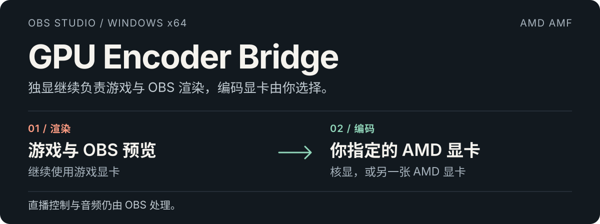
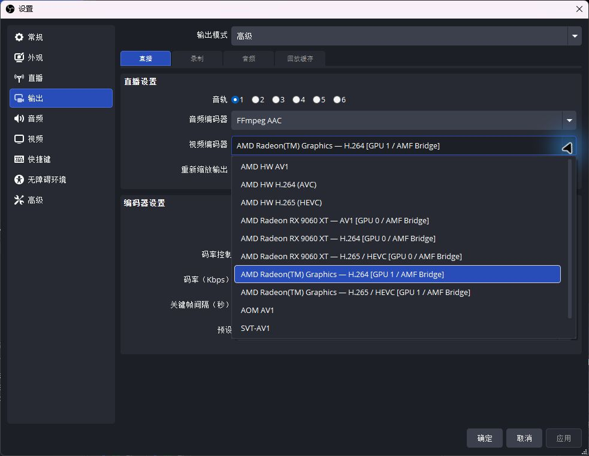
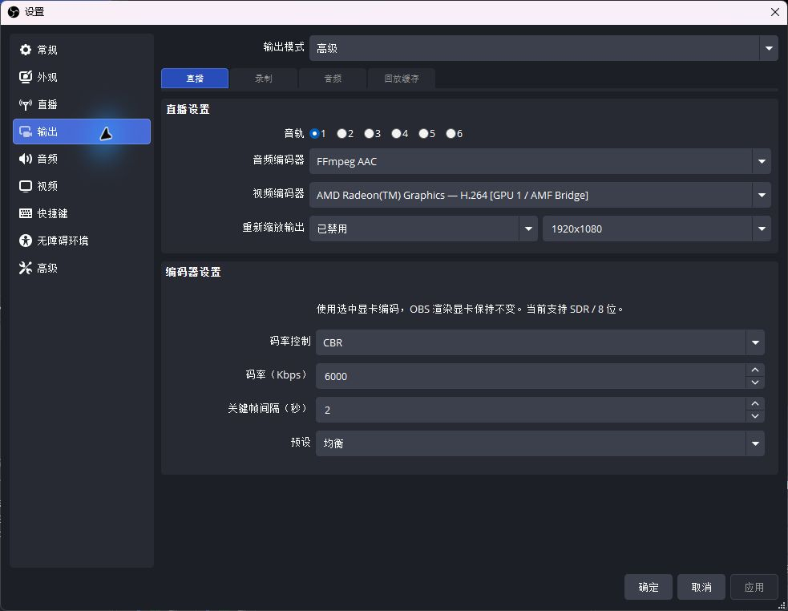
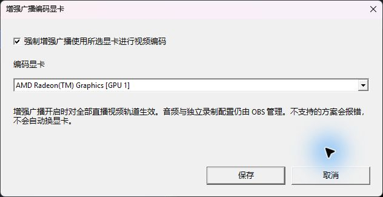
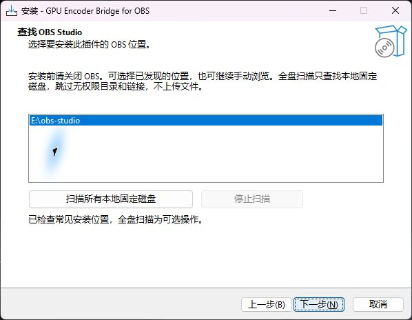

  <a href="../README.md">English</a> · <strong>简体中文</strong> · <a href="README.zh-TW.md">繁體中文（台灣）</a> · <a href="README.ja-JP.md">日本語</a> · <a href="README.ko-KR.md">한국어</a>

  

**[下载 Windows 安装器 →](https://github.com/1728643928/obs-gpu-encoder/releases/download/v0.3.2/GPU-Encoder-Bridge-0.3.2-windows-x64-setup.exe)** · [全部下载](https://github.com/1728643928/obs-gpu-encoder/releases) · [文档索引](README.md) · [问题反馈](https://github.com/1728643928/obs-gpu-encoder/issues)

**0.3.2** · Windows x64 · OBS Studio 33.x · AMD AMF · GPL-2.0-or-later

**按真实显卡名选择编码设备，OBS 继续在游戏显卡上运行。**

GPU Encoder Bridge 在 OBS 原生编码器列表中加入显卡名称，让 AMD 核显或另一张 AMD 显卡负责编码，游戏、显示器与 OBS 渲染仍使用游戏显卡。无需更改 Windows 显卡偏好设置或显示器插线。

直播平台、音频、网络连接与开始/停止直播仍由 OBS 负责，无需另开控制软件。

## 为什么会有这个插件

**电脑里有两张 AMD 显卡，默认编码器列表却没有按显卡分别列出。** 这个项目起源于一台 **Ryzen 7 9700X 核显＋Radeon RX 9060 XT 独显** 的电脑：OBS 默认提供的是 **AMD HW H.264 (AVC)**、**AMD HW H.265 (HEVC)** 这样的 AMD 编码类型，而不是每张实体显卡各一项。OBS 33 的[内置纹理 AMF 编码路径](https://github.com/obsproject/obs-studio/blob/33.0.0/plugins/obs-ffmpeg/texture-amf.cpp#L356-L373)使用 OBS 的渲染显卡。

当时的需求很直接：**游戏、显示器和 OBS 继续使用 RX 9060 XT，直播编码交给 9700X 核显**，同时保持 Windows 显卡偏好设置和显示器接线不变，也不给核显接显示器。**GPU Encoder Bridge 就是为了解决“单独选择编码显卡”这个问题而创建的。**

| 原始环境中的编码器选择 | 显示示例（简写） |
| --- | --- |
| OBS 默认选项 | **AMD HW H.264 (AVC)**，按 AMD／编码格式展示。 |
| 安装本插件后 | 分别出现 **RX 9060 XT — H.264** 与 **Radeon(TM) Graphics — H.264**，各自绑定对应显卡。 |

插件会逐张探测 AMD 显卡，列出实际支持的 **显卡型号＋编码格式**，让你明确指定哪张实体显卡编码，OBS 仍使用原来的渲染显卡。

## 在 OBS 里是什么样

打开 **设置 → 输出 → 高级 → 直播 → 视频编码器**，选择带 **AMF Bridge** 后缀的条目。

  

这是 0.3.0-preview 的实际界面，展示两张显卡与各自可用格式。**AMD HW** 是 OBS 自带编码器；本插件新增的是标有显卡名称与 **AMF Bridge** 的条目。直播平台可能隐藏不支持的格式。

查看选中核显后的完整编码设置

  

这里选择的是 Ryzen 7 9700X 核显。码率和预设是示例配置，不代表性能测试结果。本页截图使用简体中文界面；切换页面语言即可查看对应的英文、台湾繁体中文、日文或韩文截图。

## 增强广播也能指定编码显卡

**平台范围：** 这是 OBS 的 **多轨视频（Multitrack Video）** 模式，Twitch 将其称为 **增强广播（Enhanced Broadcasting）**。OBS 33 也为 Amazon IVS、Whowatch、PandaTV 和 Dolby OptiView Real-time 配置了接入，能否使用取决于平台及账号。**YouTube 没有接入这个 OBS 模式**，在普通输出设置中选择显卡名称对应的 AMF Bridge 编码器即可。是否支持 H.264／HEVC／AV1 是另一回事。上游接入不等于本插件已在这些平台完成端到端实测。[平台范围详情](enhanced-broadcasting.md#platform-scope)

保留 OBS 的增强广播开启，在 **工具 → GPU Encoder Bridge：增强广播** 中勾选强制绑定、选择核显并保存。设置按 OBS 配置文件分别保存，平台方案生成后会替换全部直播视频轨道，即使原来的编码器下拉框被锁定也能生效。

独立录制的编码选项与设置保持独立；增强广播自带的直播副本跟随直播编码。显卡缺失或方案不兼容时阻止启动，不自动改用其他显卡。[操作步骤、原理与限制 →](enhanced-broadcasting.md)

  

## 已在真实双显卡环境验证

**渲染：Radeon RX 9060 XT · 编码：Ryzen 7 9700X 核显，H.264**

| 检查 | 实际结果 |
| --- | --- |
| 0.2.0 独立编码进程测试 | 1080p60 输入 300 帧，输出 300 个数据包、3 个关键帧。 |
| 此前 OBS 本地 RTMP 测试 | 约 47 秒视频和音频成功接收、解码；OBS 仍在 RX 9060 XT 上渲染。 |
| 0.2.0 四语安装器检查 | 四种语言安装、卸载通过；无效路径与被占用目标遭拒绝。 |

这些是有明确范围的验证记录，不是游戏性能跑分。HEVC/AV1 仅有能力探测，未完成同等级 OBS 直播验收；公网直播平台接收尚未验证。[查看完整验证记录 →](validation.md)

## 可以选择什么

- **显卡与编码格式。** 每个条目同时显示真实设备及 H.264、HEVC 或 AV1，实际探测成功才提供；直播平台可能进一步限制格式。
- **熟悉的 OBS 参数。** 支持 CBR/VBR、码率、关键帧间隔，以及速度、均衡、质量预设。
- **明确绑定设备。** 过滤仅用于间接显示的虚拟别名，真实同型号双卡分别保留；出错不会悄悄换显卡或改为软件编码。
- **五种语言。** 插件、EXE 安装器与入门文档均提供英文、简体中文、繁体中文（台湾）、日文和韩文。

## 安装并开始直播

1. **关闭 OBS**，下载上方安装器。
2. 选择语言与 **OBS 根目录**。向导自动查找常见位置，也可扫描全部本地固定磁盘、随时停止，或手动浏览；复制前检查 OBS 33.x x64 及必需 DLL。
3. 启动 OBS → **设置 → 输出 → 高级 → 直播**，选择目标显卡名称对应的 **AMF Bridge** 编码器。
4. 在 OBS 中配置平台与音频，照常点击 **开始直播**。

条目示例：**AMD Radeon(TM) Graphics — H.264 [GPU 1 / AMF Bridge]**。GPU 编号是当前 DXGI 枚举顺序，硬件变更后请重新检查。

可从 H.264、CBR、关键帧 2 秒、均衡开始设置，码率按平台要求填写。使用 Twitch 增强广播时，另在插件的[增强广播设置](enhanced-broadcasting.md)中指定编码显卡。

查看安装器如何查找 OBS

  

向导列出发现的 OBS 位置，支持可选全盘扫描，继续后校验 OBS 根目录。图中展示的是安装前的查找步骤。

具体安装位置与全盘扫描范围

选择 OBS 根目录，安装器会自动放入对应插件目录：

| OBS 根目录下 | 文件 |
| --- | --- |
| `obs-plugins/64bit/` | `obs-gpu-encoder.dll` 与 `obs-gpu-encoder-worker.exe` |
| `data/obs-plugins/obs-gpu-encoder/` | 五语资源、声明与卸载器。 |

扫描只枚举本地固定磁盘目录，不读取个人文档内容、不上传文件。无权限目录与重解析点会跳过；网络盘、可移动盘及仅通过链接挂载的卷请手动浏览。大容量磁盘可能耗时，可随时停止。

默认安装器为受保护目录申请管理员权限；可写的便携安装可使用 **/CURRENTUSER**。目前 EXE 未数字签名。[安装器详细说明](installer.md)

手动 ZIP 安装与卸载

将 ZIP 中的 **obs-plugins** 和 **data** 合并到 OBS 根目录。插件 DLL 与 worker EXE 必须一起安装，不要覆盖 OBS 自带 DLL。

卸载前关闭 OBS，使用 Windows 已安装的应用中的 GPU Encoder Bridge，或运行目标 OBS 下 **data/obs-plugins/obs-gpu-encoder/uninstall/unins000.exe**。安装器只移除其记录的本插件文件，保留 OBS、配置与其他插件。手动安装请先改选其他编码器，再删除本插件 DLL、worker 和对应数据目录。

## 支持范围与取舍

| 项目 | 当前预览版 |
| --- | --- |
| 平台 | Windows x64；OBS 33 / avcodec 62 / avutil 60 ABI。 |
| 编码 | AMD AMF；设备探测成功的 H.264、HEVC 与 AV1。 |
| 视频 | SDR / NV12 / 8 位，拒绝 HDR 与 10 位。 |
| 其他厂商 | 尚未实现 Intel QSV 与 NVIDIA NVENC。 |
| 画面传输 | 系统内存 → 本地编码进程 → 指定 AMD 显卡，尚未实现跨卡零拷贝。 |

内部隐藏进程隔离 AMF 初始化、明确绑定编码显卡，再将编码数据返回 OBS。跨卡传输有成本，不保证游戏性能提升。其他显卡、其他 OBS ABI 和公网平台仍需更多验证。[架构](architecture.md) · [测试](testing.md)

## 致谢与借鉴来源

本项目使用或参考了以下开源成果，并明确列出各自涉及的范围。

| 项目 | 使用或借鉴的内容 |
| --- | --- |
| [OBS Studio](https://github.com/obsproject/obs-studio/tree/33.0.0) | 使用编码器接口与头文件，开发时参考了其 AMF 实现；渲染、音频与推流仍由 OBS 完成。 |
| [FFmpeg](https://github.com/FFmpeg/FFmpeg/tree/n8.0) | 通过 OBS 提供的 libavcodec/libavutil DLL 使用其实际 AMF 编码实现与 D3D11 硬件上下文接口。 |
| [AMD AMF](https://github.com/GPUOpen-LibrariesAndSDKs/AMF) | 使用显卡驱动提供的硬件编码运行时；选卡与验证参考了 AMD 官方 FFmpeg/AMF 指南。 |
| [Inno Setup](https://github.com/jrsoftware/issrc/tree/is-6_7_3) | 使用 EXE 安装引擎及标准界面翻译；简体中文文件直接沿用上游原文件，作者署名为 [Zhenghan Yang / Kira](https://github.com/kira-96/Inno-Setup-Chinese-Simplified-Translation)。 台湾繁体资源沿用上游 **Enfeng Tsao** 的翻译，保留 **Samuel Lee** 的既有署名，仅调整语言选择名称。 |
| [Zig](https://github.com/ziglang/zig/tree/0.14.1) 及其附带的 LLVM/MinGW 工具链 | 用于编译、链接、Windows 头文件及链接进程序的 C/C++ 运行时组件。 |
| [oil-oil/beautify-github-readme](https://github.com/oil-oil/beautify-github-readme) | 参考其 README 内容组织与视觉设计指导；显卡分工 SVG 和生成脚本为本仓库制作。 |

[查看具体参考位置、直接沿用文件与许可证声明 →](../THIRD-PARTY.md)

## 完整开源，可以继续维护

本项目编写的插件、编码进程、安装逻辑、翻译、测试与发版工作流按 **GPL-2.0-or-later** 公开；沿用的第三方组件与文件保留各自上游许可证及声明。没有闭源收费组件、CLA、遥测或在线激活。

任何人可 Fork、创建分支、修改并按许可证再发布。Fork 可用自己仓库的 GitHub Actions 临时令牌发布自己的 Releases，无需原作者私钥或电脑。向原仓库发版仍需所有者授予权限。

[贡献指南](../CONTRIBUTING.md) · [治理与接手](../GOVERNANCE.md) · [发布自己的 Fork](releasing.md) · [许可证](../LICENSE) · [第三方声明](../THIRD-PARTY.md)

从源码构建

需要 Windows x64、Node.js 22+ 与 Git，无需 Visual Studio 或私有 SDK。

~~~powershell
node scripts/check-locales.mjs
node scripts/build.mjs --download-obs --tests
node scripts/build-installer.mjs
node scripts/package.mjs
~~~

已有 OBS 时可将 **--download-obs** 换成 **--obs-root "C:\Program Files\obs-studio"**。公开工具链与源码按固定 SHA-256 校验。产物位于 **dist/** 和 **release/**；构建不安装插件、不修改 OBS 配置。

项目目录导航

| 目录 | 职责与入口 |
| --- | --- |
| [src/](../src/README.md) | OBS 原生接入、AMD 后端、显卡筛选与进程通信。 |
| [installer/](../installer/README.md) | EXE 向导、OBS 查找、路径校验与五语提示。 |
| [scripts/](../scripts/README.md) | 构建、翻译检查、安装测试、打包与发版。 |
| [tests/](../tests/README.md) | CPU 回归、实际显卡测试与文件锁辅助工具。 |
| [data/](../data/README.md) | OBS 五语资源与翻译规则。 |
| [docs/](README.md) | 入门、架构、测试、验证与发布交接。 |
| [.github/](../.github/AUTOMATION.md) | CI、发版权限与问题模板。 |
| [assets/readme/](../assets/readme/README.md) | 可编辑五语视觉与无依赖生成脚本。 |
| [third-party/](../third-party/README.md) | 运行时、工具链与安装器的第三方许可原文。 |

[CHANGELOG.md](../CHANGELOG.md) 记录版本变化，[version.json](../version.json) 控制构建和发版版本；[.gitattributes](../.gitattributes) 管理换行，[.gitignore](../.gitignore) 排除生成文件。贡献、权限、许可证与依赖说明见上方链接。

