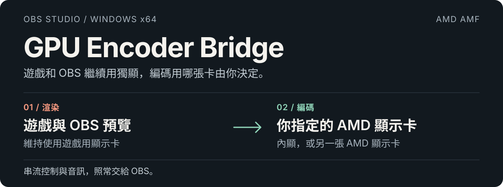
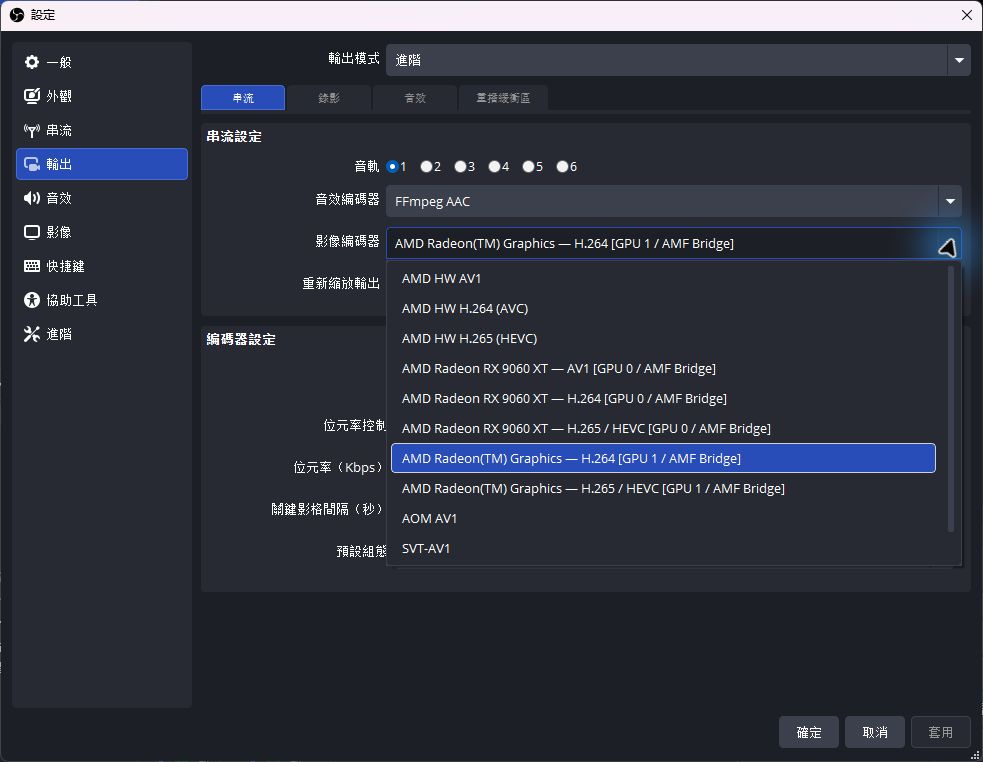
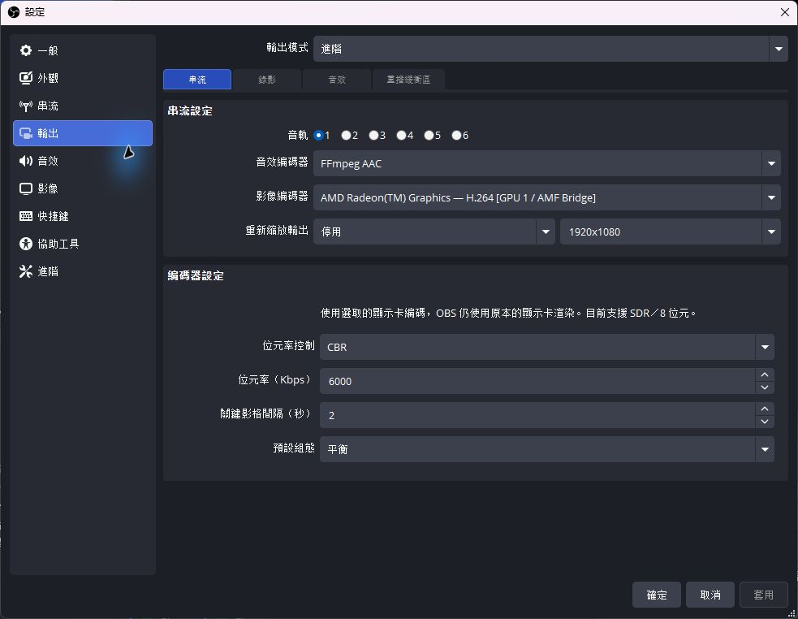
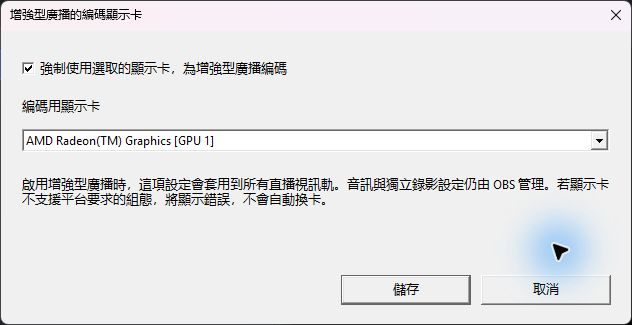
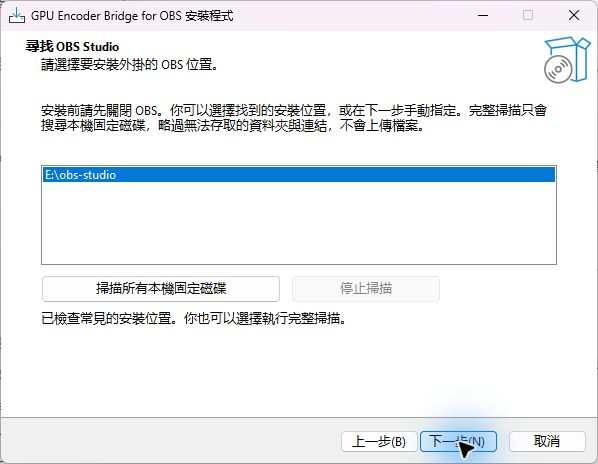

  <a href="../README.md">English</a> · <a href="README.zh-CN.md">简体中文</a> · <strong>繁體中文（台灣）</strong> · <a href="README.ja-JP.md">日本語</a> · <a href="README.ko-KR.md">한국어</a>

  

**[下載 Windows 安裝程式 →](https://github.com/1728643928/obs-gpu-encoder/releases/download/v0.3.2/GPU-Encoder-Bridge-0.3.2-windows-x64-setup.exe)** · [所有下載項目](https://github.com/1728643928/obs-gpu-encoder/releases) · [文件索引](README.md) · [回報問題](https://github.com/1728643928/obs-gpu-encoder/issues)

**0.3.2** · Windows x64 · OBS Studio 33.x · AMD AMF · GPL-2.0-or-later

**想用哪張顯示卡編碼，就直接選它的名稱。OBS 繼續跑在遊戲用的獨顯上。**

GPU Encoder Bridge 是 OBS 的 Windows 外掛。它會在編碼器清單中加上顯示卡名稱，讓你把編碼工作交給 AMD 內顯或另一張 AMD 顯示卡，遊戲、螢幕和 OBS 渲染則維持使用原本的獨顯。不用改 Windows 的顯示卡偏好設定，也不用重接螢幕。

直播平台、音訊、網路連線與開始／停止串流，還是照常交給 OBS 處理，不用另外開控制程式。

## 為什麼會做這個外掛

**電腦裡明明有兩張 AMD 顯示卡，預設編碼器清單卻沒有把它們分開列出來。** 這個專案起初是為了一台 **Ryzen 7 9700X 內顯＋Radeon RX 9060 XT 獨顯** 的電腦而做的。在這套配置上，OBS 顯示的是 **AMD HW H.264 (AVC)**、**AMD HW H.265 (HEVC)** 這類編碼選項，而不是每張實體顯示卡各有一個選項。OBS 33 的[內建 AMF 編碼實作](https://github.com/obsproject/obs-studio/blob/33.0.0/plugins/obs-ffmpeg/texture-amf.cpp#L356-L373)會使用 OBS 的渲染顯示卡。

當時想做的事很單純：**遊戲、螢幕與 OBS 繼續用 RX 9060 XT，直播編碼改交給 9700X 內顯**，而且不用改 Windows 顯示卡設定，也不必替內顯接一台螢幕。**GPU Encoder Bridge 就是為了補上「獨立選擇編碼顯示卡」這個選項而誕生的。**

| 原本這套配置的選擇方式 | 顯示範例（簡寫） |
| --- | --- |
| OBS 預設選項 | **AMD HW H.264 (AVC)**，按 AMD 編碼類型與格式列出。 |
| 安裝外掛後 | **RX 9060 XT — H.264** 與 **Radeon(TM) Graphics — H.264** 分開列出，各自綁定對應的顯示卡。 |

外掛會逐一測試 AMD 顯示卡，列出實際支援的 **顯示卡型號＋編碼格式**。你可以明確指定哪張卡負責編碼，OBS 仍維持原本的渲染顯示卡。

## 在 OBS 裡怎麼選

開啟 **設定 → 輸出 → 進階 → 串流 → 影像編碼器**，選擇名稱後面有 **AMF Bridge** 的項目。

  

**AMD HW** 是 OBS 內建的編碼器；外掛新增的選項會標示顯示卡名稱與 **AMF Bridge**。清單裡能看到哪些格式，也取決於直播平台的支援範圍。

看看選好內顯之後的編碼設定

  

這裡選的是 Ryzen 7 9700X 內顯。位元率和預設組態只是設定範例，不代表效能測試結果。本頁圖片使用繁體中文（台灣）介面；切換上方的頁面語言，就能看到對應語言的圖片。

## 增強型廣播也能指定顯示卡

**先確認平台是否支援：** OBS 的這套機制叫 **Multitrack Video（多軌視訊）**，Twitch 稱為 **Enhanced Broadcasting（增強型廣播）**。OBS 33 也為 Amazon IVS、Whowatch、PandaTV 和 Dolby OptiView Real-time 設有接入設定，是否能使用仍要看平台與帳號。**YouTube 沒有接入 OBS 的這個模式**，使用一般輸出設定，選擇對應顯示卡的 AMF Bridge 編碼器即可。支援 H.264／HEVC／AV1，和支援增強型廣播是兩回事。OBS 已接入的平台，也不代表本外掛已完成該平台的實際串流驗證。[平台範圍說明](enhanced-broadcasting.md#platform-scope)

在 **工具 → GPU Encoder Bridge：增強型廣播** 中勾選強制使用指定顯示卡，選好內顯後按 **儲存**。OBS 的增強型廣播可以保持啟用；即使原本的編碼器下拉選單鎖住了，外掛仍會在平台傳回組態後，將所有直播視訊軌改用你指定的顯示卡編碼。每個 OBS 設定檔會各自儲存這項選擇。

獨立錄影的編碼器選項與設定會維持原樣。增強型廣播附帶的串流副本，則與直播共用編碼器。若找不到顯示卡，或顯示卡不支援平台要求的組態，外掛會中止串流，不會自動改用其他顯示卡。[設定方式、運作原理與限制 →](enhanced-broadcasting.md)

  

## 已實際驗證的範圍

**渲染：Radeon RX 9060 XT · 編碼：Ryzen 7 9700X 內顯，H.264**

| 測試 | 實際結果 |
| --- | --- |
| 0.2.0 獨立編碼程序測試 | 1080p60 輸入 300 個影格，輸出 300 個封包，包含 3 個關鍵影格。 |
| 先前的 OBS 本機 RTMP 測試 | 成功接收並解碼約 47 秒的影像與音訊，OBS 仍由 RX 9060 XT 渲染。 |
| 0.2.0 四語安裝測試 | 四種語言皆完成安裝與解除安裝測試，並拒絕無效路徑和使用中的目標檔案。 |

這些結果都有明確的測試範圍，不是遊戲效能比較。HEVC／AV1 目前做的是編碼能力探測，尚未完成同等程度的 OBS 串流驗證；公開直播平台的接收情況也還沒驗證。[完整驗證紀錄 →](validation.md)

## 外掛提供哪些選項

- **顯示卡與編碼格式一起選。** 每個項目都標示實體裝置名稱，以及 H.264、HEVC 或 AV1。只有實際探測成功的組合才會列出，直播平台還可能進一步限制格式。
- **在 OBS 裡直接調參數。** 可設定 CBR／VBR、位元率、關鍵影格間隔，以及速度優先／平衡／品質優先組態。
- **明確綁定選取的顯示卡。** 略過僅用於間接顯示的虛擬別名；實際存在的同型號顯示卡仍分開列出。發生錯誤時，不會偷偷換卡或改用軟體編碼。
- **五種介面語言。** 外掛、EXE 安裝程式與入門說明都有英文、簡體中文、繁體中文（台灣）、日文和韓文。台灣繁中用詞與句子另外撰寫，不是只把簡體字換成繁體字。

## 安裝好，就照常開始直播

1. **先關閉 OBS**，再下載上方的安裝程式。
2. 選擇語言與 **OBS 安裝根目錄**。安裝程式會先找常見位置；你也可以掃描所有本機固定磁碟，或手動指定路徑。複製檔案前會檢查 OBS 33.x x64 與必要的 DLL，完整掃描也能隨時停止。
3. 開啟 OBS → **設定 → 輸出 → 進階 → 串流**，選擇你要使用的顯示卡所對應的 **AMF Bridge** 編碼器。
4. 在 OBS 設好直播平台與音訊，照常按 **開始串流**。

項目範例：**AMD Radeon(TM) Graphics — H.264 [GPU 1 / AMF Bridge]**。GPU 編號依目前的 DXGI 列舉順序產生；更換硬體後，請再確認一次選取的顯示卡。

可以先從 H.264、CBR、關鍵影格間隔 2 秒與平衡組態開始，位元率則依平台需求設定。若使用 Twitch 增強型廣播，請另外到外掛的[增強型廣播設定](enhanced-broadcasting.md)指定編碼顯示卡。

看看安裝程式怎麼找到 OBS

  

安裝程式會列出找到的 OBS 位置，讓你選擇或執行完整掃描，再確認安裝根目錄。圖片顯示的是安裝前的尋找步驟。

會裝在哪裡？完整掃描會做什麼？

選好 OBS 安裝根目錄後，檔案會自動放進這份 OBS 的外掛目錄：

| OBS 根目錄下的位置 | 檔案 |
| --- | --- |
| **obs-plugins/64bit/** | **obs-gpu-encoder.dll** 與 **obs-gpu-encoder-worker.exe** |
| **data/obs-plugins/obs-gpu-encoder/** | 五語資源、授權聲明與解除安裝程式。 |

掃描只會列舉本機固定磁碟的資料夾，不讀取個人文件內容，也不會上傳檔案。無法存取的資料夾與重解析點會略過；網路磁碟、卸除式磁碟與只能透過連結存取的磁碟區，請手動指定。磁碟較大時可能需要一些時間，可以隨時停止。

預設安裝程式會要求系統管理員權限，以便寫入受保護的位置；若是可寫入的可攜版 OBS，可使用 **/CURRENTUSER**。目前 EXE 尚未加上數位簽章。[安裝程式說明](installer.md)

手動用 ZIP 安裝，以及如何移除

把 ZIP 裡的 **obs-plugins** 與 **data** 資料夾合併到 OBS 根目錄。外掛 DLL 和 worker EXE 必須放在一起，請保留 OBS 原本的 DLL。

解除安裝前請先關閉 OBS，再到 Windows 的已安裝應用程式中選擇 GPU Encoder Bridge，或執行這份 OBS 下的 **data/obs-plugins/obs-gpu-encoder/uninstall/unins000.exe**。安裝程式只會移除它記錄的外掛檔案，保留 OBS、設定檔與其他外掛。若是手動安裝，請先改選其他編碼器，再移除此外掛的 DLL、worker 與對應資料目錄。

## 支援範圍與取捨

| 項目 | 目前支援範圍 |
| --- | --- |
| 系統 | Windows x64；OBS 33／avcodec 62／avutil 60 ABI。 |
| 編碼 | AMD AMF；裝置探測成功的 H.264、HEVC 與 AV1。 |
| 視訊 | SDR／NV12／8 位元；不接受 HDR 與 10 位元。 |
| 其他廠牌 | 尚未實作 Intel QSV 與 NVIDIA NVENC。 |
| 影格傳輸 | 系統記憶體 → 本機編碼程序 → 指定的 AMD 顯示卡，尚未實作跨卡零複製。 |

背景編碼程序會隔離 AMF 初始化、綁定指定的顯示卡，再把編碼封包傳回 OBS。跨卡傳輸仍有成本，因此無法保證遊戲效能一定會提升。其他顯示卡、OBS ABI 版本與公開平台還需要更多驗證。[架構](architecture.md) · [測試](testing.md)

## 使用與參考了哪些專案

本專案使用或參考了以下開放原始碼成果，並列出各自的用途。

| 專案 | 使用或參考範圍 |
| --- | --- |
| [OBS Studio](https://github.com/obsproject/obs-studio/tree/33.0.0) | 使用編碼器 API 與標頭檔，開發時參考 AMF 實作；渲染、音訊與串流發布仍由 OBS 負責。 |
| [FFmpeg](https://github.com/FFmpeg/FFmpeg/tree/n8.0) | 透過 OBS 提供的 libavcodec／libavutil DLL，使用其 AMF 編碼實作與 D3D11 硬體裝置 API。 |
| [AMD AMF](https://github.com/GPUOpen-LibrariesAndSDKs/AMF) | 使用顯示卡驅動程式提供的硬體編碼執行環境，選卡與驗證方式參考 AMD 的 FFmpeg／AMF 指南。 |
| [Inno Setup](https://github.com/jrsoftware/issrc/tree/is-6_7_3) | 使用 EXE 安裝引擎與標準介面翻譯。簡中資源署名為 [Zhenghan Yang／Kira](https://github.com/kira-96/Inno-Setup-Chinese-Simplified-Translation)；繁中資源署名為 Enfeng Tsao，並保留 Samuel Lee 的既有翻譯署名。專案另外調整語言名稱為「繁體中文（台灣）」。 |
| [Zig](https://github.com/ziglang/zig/tree/0.14.1) 與隨附的 LLVM／MinGW 工具鏈 | 用於編譯、連結，以及 Windows 標頭檔與程式所連結的 C／C++ 執行階段元件。 |
| [oil-oil/beautify-github-readme](https://github.com/oil-oil/beautify-github-readme) | 參考 README 的內容層次與視覺設計；顯示卡分工 SVG 與產生腳本由本專案製作。 |

[完整來源、沿用檔案與授權聲明 →](../THIRD-PARTY.md)

## 完整開放原始碼，也方便接手

本專案撰寫的外掛、編碼程序、安裝邏輯、翻譯、測試與發布流程，皆採 **GPL-2.0-or-later** 授權。沿用的第三方元件與檔案，保留各自的上游授權與聲明。沒有封閉原始碼的付費元件、CLA、遙測或線上啟用機制。

任何人都可以 Fork、建立分支、修改，並依授權條款再次發布。Fork 可用自己儲存庫的 GitHub Actions 暫時性權杖發布 Releases，不需要原作者的私鑰或電腦。若要直接替原始儲存庫發布，仍須由擁有者授予權限。

[參與貢獻](../CONTRIBUTING.md) · [維護權限與接手方式](../GOVERNANCE.md) · [發布自己的 Fork](releasing.md) · [授權條款](../LICENSE) · [第三方聲明](../THIRD-PARTY.md)

從原始碼建置

需要 Windows x64、Node.js 22+ 與 Git，不用安裝 Visual Studio 或私有 SDK。

~~~powershell
node scripts/check-locales.mjs
node scripts/build.mjs --download-obs --tests
node scripts/build-installer.mjs
node scripts/package.mjs
~~~

若電腦上已有 OBS，可把 **--download-obs** 改成 **--obs-root "C:\Program Files\obs-studio"**。公開下載的工具鏈與原始碼，都會依固定的 SHA-256 校驗。建置結果放在 **dist/** 與 **release/**，建置過程不會安裝外掛，也不會修改 OBS 設定檔。

專案目錄導覽

| 目錄 | 從這裡開始看 |
| --- | --- |
| [src/](../src/README.md) | OBS 原生整合、AMD 後端、顯示卡篩選與程序間通訊。 |
| [installer/](../installer/README.md) | EXE 安裝精靈、OBS 搜尋、路徑檢查與五語提示。 |
| [scripts/](../scripts/README.md) | 建置、語言檢查、安裝測試、封裝與發布。 |
| [tests/](../tests/README.md) | CPU 回歸測試、實體顯示卡測試與檔案鎖定工具。 |
| [data/](../data/README.md) | OBS 五語資源與翻譯規則。 |
| [docs/](README.md) | 入門、架構、測試、驗證與發布交接。 |
| [.github/](../.github/AUTOMATION.md) | CI、發布權限與問題回報範本。 |
| [assets/readme/](../assets/readme/README.md) | 可編輯的五語視覺素材與不需額外套件的產生腳本。 |
| [third-party/](../third-party/README.md) | 執行階段、工具鏈與安裝程式的第三方授權原文。 |

[CHANGELOG.md](../CHANGELOG.md) 記錄版本變更；[version.json](../version.json) 決定建置與發布的版本；[.gitattributes](../.gitattributes) 管理換行；[.gitignore](../.gitignore) 排除產生的檔案。貢獻、權限、授權與相依元件的說明，可從上方連結找到。

